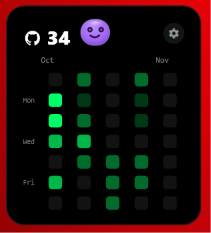

# GitWidget — SAHAJ

<p align="center">
  
</p>

<h3 align="center">Your GitHub Activity, Right on Your Desktop.</h3>

<p align="center">
  A lightweight native Windows widget that displays your GitHub contribution heatmap.
  <br />
  Built with C# and WPF.
</p>

<p align="center">
  
  
  
  
</p>

<p align="center">
  <a href="#screenshots">Screenshots</a> •
  <a href="#features">Features</a> •
  <a href="#installation">Installation</a> •
  <a href="#settings">Settings</a> •
  <a href="#development">Development</a>
</p>

---

## About

GitWidget is a small desktop widget that lets you check your GitHub activity without opening your browser.

- Displays your GitHub contribution heatmap.
- Shows your daily contribution count.
- Supports 30-day, 6-month, and 1-year views.
- Offers multiple themes and customization options.
- Runs directly on your Windows desktop.

<a id="-screenshots" name="-screenshots"></a>
## Screenshots

<br />

### Contribution Heatmaps

<br />

#### **Panoramic 6-Month Timeline View**

<p align="center">
  
</p>

<br /><br />

#### **Panoramic 1-Year Annual View**

<p align="center">
  
</p>

<br /><br />

### 30-Day Compact Views

<br />

<table>
  <tr>
    <td width="50%" align="center">
      <br />
      <b>Apple Monochrome (B&amp;W)</b>
      <br /><br />
      
      <br /><br />
    </td>
    <td width="50%" align="center">
      <br />
      <b>Liquid Glass</b>
      <br /><br />
      
      <br /><br />
    </td>
  </tr>
  <tr>
    <td width="50%" align="center">
      <br />
      <b>GitHub Classic</b>
      <br /><br />
      
      <br /><br />
    </td>
    <td width="50%" align="center">
      <br />
      <b>GitHub Dark</b>
      <br /><br />
      
      <br /><br />
    </td>
  </tr>
  <tr>
    <td colspan="2" align="center">
      <br />
      <b>Aurora Teal</b>
      <br /><br />
      
      <br /><br />
    </td>
  </tr>
</table>

<br /><br />

### Activity Analytics &amp; Deep Details

<br />

<p align="center">
  
</p>

<br /><br />

## Features

- **Contribution Heatmap** — View your daily GitHub activity.
- **Three Time Ranges** — Switch between 30 days, 6 months, and 1 year.
- **Six Themes** — Apple Light, Apple B&W, Liquid Glass, GitHub Classic, Midnight OLED, and Aurora Teal.
- **Custom Shapes** — Choose from six contribution cell shapes.
- **Activity Analytics** — View contribution totals, streaks, and activity trends.
- **Desktop Widget** — Keep your heatmap visible on your desktop.
- **Custom Settings** — Adjust themes, size, position, and appearance.
- **Sound Effects** — Optional sounds for widget interactions.
- **Character Companion** — An interactive character with six expressions.
- **Lightweight** — Native C# and WPF implementation without Electron.

## Installation

### Option 1 — GUI Installer (Recommended)

1. Download or clone this repository.
2. Open the `windows-native-csharp` folder.
3. Run `GitWidget-Setup.exe`.
4. Follow the installation instructions.
5. Launch GitWidget from your desktop.

### Option 2 — Direct Run

If .NET 8 Desktop Runtime is installed:

1. Open the application folder.
2. Run `GitHubDesktopWidget.exe`.

### Option 3 — Install Script

Run either:

- `Install.bat`
- `Install.ps1`

These scripts handle the required runtime installation and launch the widget.

## Controls

| Action | How to use |
|---|---|
| Move widget | Click and drag |
| Open settings | Click the settings icon |
| Quick menu | Right-click the widget |
| Change time range | Select 30D, 6M, or 1Y |
| View daily activity | Hover over a heatmap cell |
| Change character | Click the character |
| Mute sounds | Use Settings or the right-click menu |
| Lock position | Right-click → Disable Moving |
| Keep on desktop | Right-click → Keep on Desktop |
| Start with Windows | Right-click → Start with Windows |
| Exit | Right-click → Quit Widget |

## Settings

Customize your widget using the built-in settings panel.

- GitHub username
- Theme and contribution shape
- Heatmap time range
- Widget position
- Lock and desktop settings
- Sound effects
- Startup preferences

Settings are stored locally:

```text
%APPDATA%\GitHubDesktopWidget\config.json
```

## Development

### Requirements

- Windows 10 or 11
- .NET 8 SDK
- Visual Studio or VS Code

### Clone the Repository

```powershell
git clone https://github.com/SAHAJCSE/GitWidget-SAHAJ.git

cd GitWidget-SAHAJ/windows-native-csharp
```

### Build and Run

```powershell
dotnet build GitWidget.slnx

dotnet run --project GithubWidget.csproj
```

### Publish

```powershell
dotnet publish GithubWidget.csproj -c Release -r win-x64 -o Application
```

The published application will be available inside the `Application` folder.

## Project Structure

```text
windows-native-csharp/
│
├── Assets/          Application icons
├── images/          Screenshots
├── Models/          Data models and configuration
├── Services/        GitHub API and sound services
├── Setup/           Installer application
│
├── MainWindow.xaml  Main widget
├── SettingsWindow   Widget settings
├── DetailWindow     Activity analytics
│
├── GithubWidget.csproj
├── GitWidget.slnx
├── GitWidget-Setup.exe
├── Install.bat
├── Install.ps1
└── README.md
```

## Privacy

- Uses public GitHub contribution data.
- Does not require your GitHub password.
- Does not request a personal access token.
- Stores widget preferences locally.
- Does not require a browser running in the background.

## Built With

- C#
- .NET 8
- Windows Presentation Foundation (WPF)
- GitHub Contributions API

## Author

**Sahaj**

GitHub: [@SAHAJCSE](https://github.com/SAHAJCSE)

Inspired by Apple's Liquid Glass design and minimal desktop widgets.

---

<p align="center">
  Made with ❤️ by Sahaj
  <br />
  If you like this project, consider giving it a ⭐
</p>
