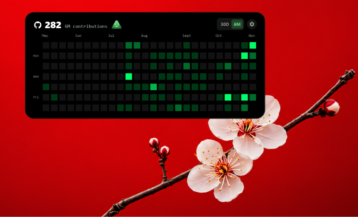
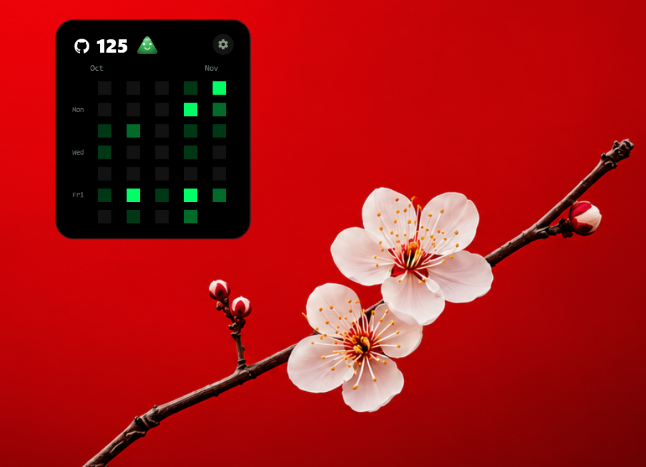
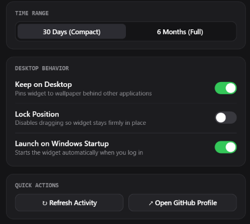

# GitWidget • SAHAJ

<p align="center">
  <b>Ultra-Compact, Native Windows 11 Desktop Activity Monitor & Contribution Heatmap</b><br>
  <i>Crafted with an Apple-inspired Liquid Glass aesthetic, pure C# &amp; WPF, zero browser overhead.</i>
</p>

<p align="center">
  
  
  
  
  
  
</p>

<p align="center">
  <a href="#-screenshots"><b>📸 Screenshots</b></a> &nbsp;•&nbsp;
  <a href="#-features"><b>✨ Features</b></a> &nbsp;•&nbsp;
  <a href="#-simple-installation"><b>🚀 Installation</b></a> &nbsp;•&nbsp;
  <a href="#-6-premium-signature-themes"><b>🎨 Themes</b></a> &nbsp;•&nbsp;
  <a href="#-configuration"><b>⚙️ Settings</b></a> &nbsp;•&nbsp;
  <a href="#-project-architecture"><b>📂 Architecture</b></a>
</p>

---

<a id="-screenshots" name="-screenshots"></a>
<a id="screenshots" name="screenshots"></a>
## 📸 Screenshots & Interface Showcase

<div align="center">

### 1. Panoramic 6-Month &amp; 1-Year Timeline Views
*Full panoramic timeline showing continuous GitHub activity rhythm, live contribution statistics, and responsive day-of-week indexing.*

<br/>



<br/>
<sub><b>[ View 1 ]</b> Panoramic Timeline • GitHub Classic Theme • 30D / 6M / 1Y Mode Toggle • Expressive Bot Companion</sub>

<br/><br/>

### 2. Compact 30-Day Activity Modes
*Designed for ultra-minimalist desktop setups with zero visual clutter. Features rolling digit counters, bouncy hover pearl gradients, and vector cell geometries.*

<br/>

<table align="center" width="94%" style="border: none; background: transparent;">
  <tr>
    <td align="center" width="50%" style="border: 1px solid #28282E; border-radius: 10px; padding: 16px; background: #121214;">
      <span style="font-size: 13px; font-weight: bold; color: #FFFFFF;">🍏 Apple Monochrome (B&amp;W)</span>
      <br/>
      <span style="font-size: 10px; color: #8E8E93;">Clean stark black-and-white minimalist design</span>
      <br/><br/>
      
      <br/><br/>
      <sub><b>Tag:</b> <code>Theme: Apple B&amp;W</code> • <code>Range: 30D</code> • <code>Shape: Rounded</code></sub>
    </td>
    <td align="center" width="50%" style="border: 1px solid #28282E; border-radius: 10px; padding: 16px; background: #121214;">
      <span style="font-size: 13px; font-weight: bold; color: #39D353;">💧 Liquid Glass Mode</span>
      <br/>
      <span style="font-size: 10px; color: #8E8E93;">Translucent obsidian glass with subtle emerald borders</span>
      <br/><br/>
      
      <br/><br/>
      <sub><b>Tag:</b> <code>Theme: Liquid Glass</code> • <code>Range: 30D</code> • <code>Shape: Circle</code></sub>
    </td>
  </tr>
  <tr>
    <td align="center" colspan="2" style="border: 1px solid #28282E; border-radius: 10px; padding: 18px; background: #121214;">
      <span style="font-size: 13px; font-weight: bold; color: #58D77B;">🌿 GitHub Classic Style (30-Day Compact)</span>
      <br/>
      <span style="font-size: 10px; color: #8E8E93;">Authentic slate palette with live companion bot &amp; Octocat badge</span>
      <br/><br/>
      
      <br/><br/>
      <sub><b>Tag:</b> <code>Theme: Classic Dark</code> • <code>Range: 30D</code> • <code>Bot: Smiling</code></sub>
    </td>
  </tr>
</table>

<br/><br/>

### 3. Apple Settings Hub &amp; Deep Activity Inspector
*Custom-designed Apple dark glass configuration hub and sliding drawer for inspecting full-year calendars, weekday/month breakdown charts, and top repository commit counts.*

<br/>

<table align="center" width="94%" style="border: none; background: transparent;">
  <tr>
    <td align="center" width="50%" style="border: 1px solid #28282E; border-radius: 10px; padding: 16px; background: #121214;">
      <span style="font-size: 13px; font-weight: bold; color: #FFFFFF;">⚙️ Apple Settings Hub</span>
      <br/>
      <span style="font-size: 10px; color: #8E8E93;">Pill-based theme selection, vector shapes, locking, sounds &amp; autostart</span>
      <br/><br/>
      
      <br/><br/>
      <sub><b>Tag:</b> <code>Settings Window</code> • <code>6 Themes</code> • <code>6 Shapes</code> • <code>Sound Controls</code></sub>
    </td>
    <td align="center" width="50%" style="border: 1px solid #28282E; border-radius: 10px; padding: 16px; background: #121214;">
      <span style="font-size: 13px; font-weight: bold; color: #FFFFFF;">🔍 Deep Activity Analytics &amp; Drawer</span>
      <br/>
      <span style="font-size: 10px; color: #8E8E93;">Charts, 6-mood character avatar, 52-week calendar &amp; commit stats</span>
      <br/><br/>
      
      <br/><br/>
      <sub><b>Tag:</b> <code>Detail Window</code> • <code>Analytics Charts</code> • <code>6 Mood Expressions</code></sub>
    </td>
  </tr>
</table>

</div>

---

## 🌟 Why GitWidget-SAHAJ?

Most modern desktop widgets are built on Electron or Chromium wrappers, dragging along 150+ MB of RAM, 200+ MB of disk bloat, and sluggish startup times. 

**GitWidget-SAHAJ** is built 100% native from the ground up using **C# and Windows Presentation Foundation (WPF)**. It interacts directly with the Windows Desktop Window Manager (DWM) for instantaneous rendering, hardware-accelerated animations, and zero background clutter.

| Metric | Typical Electron Widget | GitWidget-SAHAJ |
| :--- | :---: | :---: |
| **Disk Footprint** | ~180 MB – 320 MB | **~290 KB** |
| **Active Memory (RAM)** | ~120 MB – 220 MB | **~15 MB – 20 MB** |
| **Engine Overhead** | Chromium + Node.js | **Pure Windows API / WPF** |
| **Taskbar Presence** | Cluttered Taskbar item | **Seamless Desktop Gadget** (`ShowInTaskbar="False"`) |
| **Startup Latency** | 2.5s – 4.0s | **Instantaneous (< 100ms)** |

---

## ✨ Features

- **📊 GitHub Contribution Heatmap**: Visualizes your daily commit rhythm in a responsive, beautifully spaced calendar grid.
- **⚡ 3 Flexible Time Ranges (30D / 6M / 1Y)**:
  - `30D (Compact)`: 195px ultra-compact view for zero-distraction desktop setups.
  - `6M (Standard)`: 495px panoramic 26-week timeline view.
  - `1Y (Annual)`: 840px complete 52-week full-year panoramic activity graph.
- **🤖 Expressive 6-Emotion Character Companion (Enlarged $34 \times 30$)**:
  - Recreates all 6 signature emotional states with glossy 3D depth and specular highlights:
    - **🍏 Happy**: Peaceful upward arch eyes with a sweet smile (active today).
    - **⚡ Excited**: Electric golden yellow radiance with lightning bolt emblem and energetic open grin ($\ge 5$ commits today).
    - **🧘 Calm**: Mindful pastel lavender purple with clean dot eyes and gentle smile (consistent streaks).
    - **🥱 Bored**: Unimpressed rose pink with flat horizontal line eyes and mouth ($0$ commits today).
    - **😴 Sleepy**: Soft sky blue with relaxed drooping eyelids and a cute yawning 'o' mouth (late night hours).
    - **😤 Angry**: Fiery coral orange with furrowed angled brows and an upset pout frown (broken streak).
  - **Interactive Character Behavior**: Click the bot anytime to cycle through expressions, hear distinct sound effects, and see revealing commentary!
  - **Natural Eye Blinking**: Eyes automatically blink every ~3.6s with realistic easing physics.
- **🔊 Tactile UI Audio & Sound Effects Engine**:
  - Memory-synthesized 16-bit PCM micro-sounds (zero external audio files or latency).
  - *Bubble Pop* on cell hover, *Melodic Chimes* on Happy/Excited, *Tactile Ticks* on range switches, *Yawn Tone* on Sleepy, and *Grumble* on Angry.
  - Easily toggle or mute sounds via the right-click menu or Settings panel.
- **📈 Advanced Activity Analytics & Insights (in Activity Details)**:
  - **Weekday Activity Rhythm Chart**: Animated vertical bar chart analyzing commit density across Sundays through Saturdays.
  - **Monthly Volume Trends Chart**: 12-month bar chart showing productivity volume across January to December.
  - **Streak & Peak KPI Cards**: Annual commit totals, current streak, personal-best longest streak, and most productive weekday with percentage volume.
  - **Revealing Text Commentary**: Insights dynamically revealed with smooth opacity transitions.
- **🎨 6 Premium Signature Themes**:
  - `Apple Light Mode`: macOS off-white glass with dark typography, responsive GitHub green levels, and a fluid left-to-right sweep animation.
  - `Apple B&W`: Minimalist monochrome black-and-white aesthetic.
  - `Liquid Glass`: Translucent obsidian glass with emerald borders and soft reflections.
  - `GitHub Classic`: The authentic dark slate `#0D1117` GitHub interface.
  - `Midnight OLED`: Pure `#000000` depth with vibrant neon accents for OLED displays.
  - `Aurora Teal`: Luminous cyberpunk teal and aqua tones.
- **💠 6 Vector Contribution Shapes**:
  - `Circle` • `Rounded Square` • `Square` • `Hexagon` • `Triangle` • `Flower`
- **✨ Fluid Micro-Interactions**:
  - **Rolling Digit Counter**: Numbers roll smoothly into view with spring physics when hovered or updated.
  - **Bouncy Hover Glow**: Heatmap cells pop forward ($1.38\times$ scale) with a luminous pearl gradient on mouse hover.
  - **Left-to-Right Sweep Wave**: Switching themes triggers a staggered ripple wave across all columns.
- **🔍 Deep Activity Inspector**: Expand into a 52-week annual calendar and inspect top public repository commits in a sleek sliding activity drawer.
- **⚙️ Apple-Styled Settings Hub**: Access comprehensive controls for username, shapes, themes, view ranges, window pinning, lock mode, and startup preferences.
- **🖥️ True Desktop Wallpaper Pinning**: Stays behind open windows directly on the Windows desktop surface without covering your active work.

---

## 🚀 Simple Installation

Choose any of the simple installation methods below:

### Method 1: 1-Click GUI Setup (Recommended)
Double-click `GitWidget-Setup.exe` in this folder (or the root directory).

1. Opens the sleek **GitWidget • SAHAJ** installation window featuring fluid typing text animation.
2. Automatically detects whether **Microsoft .NET 8.0 Desktop Runtime** is installed:
   - **If already installed**: Instantly verifies and skips redundant downloads.
   - **If missing**: Automatically downloads and installs the official runtime from Microsoft silently.
3. Automatically creates a Desktop shortcut (`GitWidget - SAHAJ.lnk`) and launches the widget immediately.

### Method 2: 1-Click Batch or PowerShell
Double-click `Install.bat` (or right-click `Install.ps1` → **Run with PowerShell**).
- Installs the prerequisite via Windows Package Manager (`winget`) or official Microsoft CDN if absent.
- Immediately executes the widget.

### Method 3: Direct Portable Run
If you already have [.NET 8 Desktop Runtime](https://dotnet.microsoft.com/download/dotnet/8.0) on your PC:
- Simply double-click `GitHubDesktopWidget.exe`!
- Zero installation required; portable and self-contained configuration.

---

## 🛠️ Building from Source

To compile the application yourself using the [.NET 8 SDK](https://dotnet.microsoft.com/download/dotnet/8.0):

```powershell
# 1. Clone repository
git clone https://github.com/SAHAJCSE/github-desktop-widget.git
cd github-desktop-widget/windows-native-csharp

# 2. Build the solution (Widget + Setup GUI)
dotnet build GitWidget.slnx

# 3. Run the widget directly
dotnet run --project GithubWidget.csproj

# 4. Or compile an optimized single-file Release binary
dotnet publish GithubWidget.csproj -c Release -r win-x64 -o Application
```

The resulting standalone executable `GitHubDesktopWidget.exe` (~290 KB) will be output in `Application/`.

---

## 🎮 Controls & Shortcuts

| Action | Control |
| :--- | :--- |
| **Move Widget** | Left-click and drag anywhere on the widget surface |
| **Quick Settings Pill** | Right-click anywhere on the widget |
| **Settings Hub** | Click the **⚙️ Gear Icon** in the header or select *Widget Settings...* |
| **Toggle 30D / 6M / 1Y** | Click the `30D`, `6M`, or `1Y` pill in the top-right corner |
| **Inspect Daily Commits** | Hover over any contribution dot/cell to see count, date, and hear audio pop |
| **Interact with Bot** | Left-click character to cycle expressions (`Happy`, `Angry`, `Sleepy`, `Bored`, `Calm`, `Excited`) and play audio |
| **Toggle Sound Mute** | Right-click → *Sound Effects* or toggle in Settings |
| **Lock Position** | Right-click → *Disable Moving (Lock)* |
| **Pin Behind Apps** | Right-click → *Keep on Desktop (Behind Apps)* |
| **Start with Windows** | Right-click → *Start with Windows* |
| **Open Profile** | Right-click → *Open GitHub Profile* |
| **Quit** | Right-click → *Quit Widget* |

---

## ⚙️ Configuration & Data Storage

Settings are saved locally on your machine in:
```text
%APPDATA%\GitHubDesktopWidget\config.json
```

Sample configuration:
```json
{
  "Username": "SAHAJCSE",
  "Theme": "liquid",
  "Shape": "circle",
  "Range": "6m",
  "Locked": false,
  "Topmost": false,
  "MuteSound": false,
  "BotMood": null,
  "X": 1380.0,
  "Y": 48.0,
  "Width": 495.0,
  "Height": 160.0
}
```

- **Data Privacy**: Only fetches public contribution statistics via the open GitHub activity API. No personal access tokens, passwords, or telemetry are ever requested or transmitted.

---

## 📂 Project Architecture

```text
windows-native-csharp/
├── Assets/
│   └── icon.ico                       # High-resolution application icon
├── images/                            # Showcase screenshot gallery
│   ├── image6mongithubstyle.png       # 6-Month panoramic timeline
│   ├── image30Dblackandwhite.png      # Apple B&W 30-day view
│   ├── liquidglass30d.png             # Liquid glass 30-day view
│   ├── image30Dgithubstyle.png        # Classic dark 30-day view
│   ├── settings1.png                  # Apple settings panel
│   └── setting2.png                   # Activity details inspector
├── Models/
│   ├── ApiResponse.cs                 # GitHub public API deserialization contracts
│   ├── ContributionDay.cs             # Heatmap cell model with level normalization
│   ├── RepoContribution.cs           # Repository commit breakdown
│   ├── WidgetConfig.cs                # JSON persistent configuration model
│   └── WidgetData.cs                  # Cached timeline data structure
├── Services/
│   ├── GitHubService.cs               # Asynchronous resilient GitHub fetcher with cache
│   └── SoundService.cs                # Pure C# in-memory 16-bit PCM audio synthesizer
├── Setup/
│   ├── App.xaml                       # Setup application entrypoint
│   ├── MainWindow.xaml                # Modern Apple-glass GUI with Sahaj text animation
│   ├── MainWindow.xaml.cs             # Automated runtime detector & silent installer
│   └── GitWidgetSetup.csproj          # Setup project definition
├── DetailWindow.xaml                  # Analytics charts, 6-mood bot hero & 52-week calendar
├── DetailWindow.xaml.cs               # Weekday/monthly chart calculation & mood engine
├── MainWindow.xaml                    # Main floating widget UI (Vector shapes, 34x30 bot, 30D/6M/1Y)
├── MainWindow.xaml.cs                 # Win32 desktop interop, theme engine, rolling count, sound hooks
├── SettingsWindow.xaml                # Apple-inspired configuration panel (Range & Sound toggles)
├── SettingsWindow.xaml.cs             # Interactive settings controller
├── GithubWidget.csproj                # Main optimized WPF project definition
├── GitWidget.slnx                     # Unified .NET Solution
├── GitHubDesktopWidget.exe            # Ultra-lightweight native executable (~290 KB)
├── GitWidget-Setup.exe                # 1-Click GUI installer & launcher
├── Install.bat                        # 1-Click Batch installer
├── Install.ps1                        # 1-Click PowerShell installer
└── README.md                          # Project documentation
```

---

## 👤 Author & Acknowledgments

- **Developed by**: **Sahaj** ([@SAHAJCSE](https://github.com/SAHAJCSE))
- **Design Inspiration**: Apple Liquid Glass & macOS Desktop Widgets
- **API Support**: [jogruber/github-contributions-api](https://github.com/jogruber/github-contributions-api)

---

<p align="center">
  <sub>Built with ❤️ for the Windows 11 developer community. Star ⭐ this repository if you find it useful!</sub>
</p>
